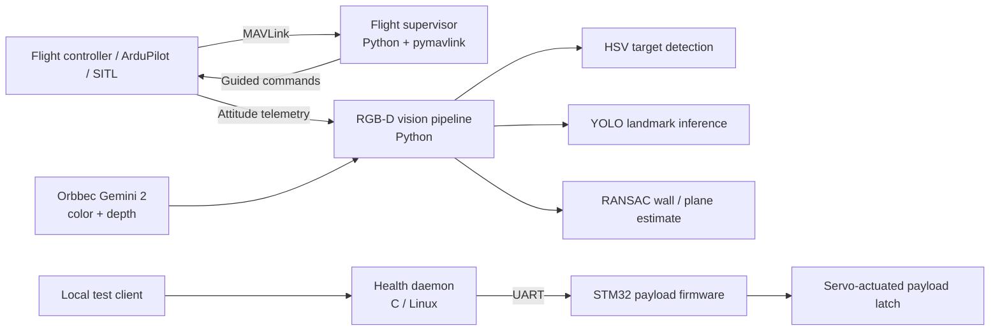

# Drone Onboard Systems

Onboard software for an autonomous drone system developed around the **AEAC Fire Reconnaissance UAS Competition**.

This repository contains software that runs on the vehicle outside the flight-controller firmware itself. It includes autonomous flight supervision, RGB-D perception, companion-computer services, and payload-controller firmware.

## Current subsystems

- **Flight supervisor** (`companion/flight_supervisor`): Python/pymavlink control and supervision layer for guided flight. It handles arming, takeoff, landing, local-position and velocity commands, command acknowledgements, telemetry tracking, and fault-response policies.
- **Vision pipeline** (`companion/vision`): Python companion-computer pipeline for Orbbec Gemini 2 color/depth capture, HSV target segmentation, optional YOLO landmark inference, RANSAC wall/plane estimation, and MAVLink attitude input.
- **Health daemon** (`companion/health_daemon`): Linux C companion-computer daemon that exposes a localhost TCP command interface, reports basic health/uptime, bridges payload commands over UART, and provides simulation commands for bench testing without the payload MCU attached.
- **Payload release firmware** (`firmware/payload-release-stm32`): STM32 firmware prototype for a servo-actuated payload-release mechanism. It currently includes UART command handling, actuator control, ultrasonic ranging, and an armed/release/retract state machine. The subsystem remains under active integration and hardware validation.

## Repository layout

```text
.
├── README.md
├── companion/
│   ├── flight_supervisor/
│   │   ├── README.md
│   │   └── main.py
│   ├── health_daemon/
│   │   ├── README.md
│   │   └── healthd.c
│   └── vision/
│       ├── README.md
│       ├── camera.py
│       ├── config.py
│       ├── main.py
│       ├── mavlink.py
│       ├── ransac_worker.py
│       ├── renderer.py
│       ├── segmentation.py
│       ├── shared_state.py
│       ├── vision_app.py
│       └── yolo_worker.py
├── docs/
└── firmware/
    └── payload-release-stm32/
        ├── README.md
        ├── architecture_diagram.png
        └── STM32 project files
```

## System overview



The flight controller remains responsible for stabilization and low-level flight control. The companion-computer software adds mission-level behavior around it: supervised autonomous commands, perception, system monitoring, and payload control.

## `companion/flight_supervisor`

MAVLink-based autonomous flight supervision and fault handling.

Current capabilities include:

- Connects to the flight controller or SITL through `pymavlink`
- Requests and tracks vehicle state from MAVLink telemetry
- Enters GUIDED mode and handles arm/disarm commands
- Commands takeoff and landing
- Sends local-NED position targets
- Sends body-frame and local-frame velocity targets
- Supports return-to-launch behavior
- Tracks `COMMAND_ACK` responses for command completion/failure
- Monitors heartbeat, battery, GPS/position, local-position, landed-state, and flight-mode health
- Maintains a fault bitmask and maps faults to responses such as warn, abort action, stop motion, land, return to base, operator handoff, or emergency abort
- Includes an executable bench/SITL flow that performs guided mode entry, arm, takeoff, position motion, relative motion, absolute motion, and landing

See [`companion/flight_supervisor/README.md`](companion/flight_supervisor/README.md) for architecture, runtime behavior, and SITL notes.

## `companion/vision`

Real-time RGB-D perception pipeline for AEAC target and landmark detection.

Current capabilities include:

- Starts an Orbbec Gemini 2 color/depth pipeline using `pyorbbecsdk`
- Aligns depth frames to the color stream
- Filters depth to a configured valid range
- Detects colored circular targets using HSV masks and contour geometry
- Runs optional YOLO inference asynchronously after target detection
- Estimates target-to-landmark distances using depth-projected 3D points
- Runs RANSAC on sampled depth points to estimate a dominant non-ground plane/wall
- Reads MAVLink `ATTITUDE` messages and stores pitch/roll for RANSAC
- Displays a live OpenCV feed with target/landmark annotations

See [`companion/vision/README.md`](companion/vision/README.md) for dependencies, configuration, and current integration caveats.

## `companion/health_daemon`

Lightweight Linux daemon for payload-subsystem command handling and status reporting.

Current capabilities include:

- Binds a local TCP command server to `127.0.0.1:5050`
- Accepts simple line-based commands from `nc` or a local test script
- Reports daemon liveness and Linux uptime from `/proc/uptime`
- Tracks accumulated daemon errors using a bitmask
- Attempts to open the configured payload MCU serial device at `115200` baud
- Forwards payload commands over UART
- Provides `SIM_*` commands for daemon-only state-machine testing
- Handles `SIGINT` and `SIGTERM` for clean shutdown

See [`companion/health_daemon/README.md`](companion/health_daemon/README.md) for build instructions and simulation examples.

## `firmware/payload-release-stm32`

STM32 payload-controller firmware prototype for the embedded side of the release subsystem.

The current codebase contains:

- UART transmit/receive routines with timeout/error handling
- Servo control through STM32 timer compare values
- Ultrasonic trigger/distance handling
- Armed, release, retract, lock, and fault state-machine logic
- Safety gating that requires the release path to be armed first

This subsystem is still being integrated and should be treated as **prototype firmware pending full hardware validation**. The firmware and companion-computer protocol will be tightened as the payload mechanism is tested on hardware.

## Quick start

### Flight supervisor / SITL

```bash
cd companion/flight_supervisor
python main.py --drone udp:127.0.0.1:14550
```

The default connection is also `udp:127.0.0.1:14550` when `--drone` is omitted. The supervisor expects a MAVLink heartbeat before running the example mission flow.

### Vision pipeline

```bash
cd companion/vision
python main.py
```

The full pipeline expects an Orbbec Gemini 2, the Orbbec Python SDK, OpenCV/NumPy/Ultralytics, and a MAVLink attitude source.

### Health daemon

```bash
cd companion/health_daemon
gcc -Wall -Wextra -std=c11 -o healthd healthd.c
./healthd
```

Then connect locally with:

```bash
nc 127.0.0.1 5050
```

### Payload release firmware

```bash
cd firmware/payload-release-stm32
```

Build and flash using the STM32 project configuration in this folder. Hardware-backed behavior is still under validation.

## Development status

This repository is an active competition codebase rather than a polished flight product. Current work is focused on:

- Migrating and validating the autonomous stack around ArduPilot
- Establishing repeatable SITL/HIL simulation workflows
- Benchmarking the next perception approach for the 2026-2027 competition cycle
- Hardening the payload-release firmware and validating it on the physical mechanism
- Improving subsystem integration, test coverage, and demonstration artifacts

The existing code documents the previous/current onboard architecture while newer competition work is being developed and evaluated.

## Project context

This project was developed as part of **McMaster Aerial Drones & Robotics** work for the AEAC Fire Reconnaissance UAS competition. The repository demonstrates work across autonomous vehicle supervision, MAVLink integration, computer vision, Linux companion-computer services, and embedded payload control.
