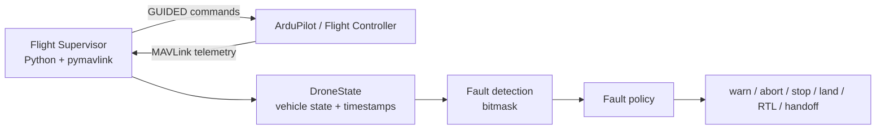

# Flight Supervisor

Companion-computer flight supervision and autonomous command layer for the AEAC drone stack.

This module communicates with the flight controller through **MAVLink** using `pymavlink`. The flight controller remains responsible for stabilization and low-level control; the supervisor sits above it and handles mission-level commands, telemetry tracking, and fault-response behavior.

## Current capabilities

- Connects to a MAVLink endpoint such as ArduPilot SITL or a physical flight controller
- Switches the vehicle into GUIDED mode
- Arms and disarms the vehicle
- Commands takeoff and landing
- Sends local-NED position targets
- Sends body-frame relative velocity commands
- Sends local-frame absolute velocity commands
- Commands return-to-launch
- Tracks `COMMAND_ACK` responses
- Monitors heartbeat, GPS/position, local position, vehicle mode, armed state, battery state, and landed state
- Maintains a fault bitmask for stale telemetry and vehicle faults
- Maps faults to responses such as logging, warning, aborting an action, stopping motion, landing, returning to base, operator handoff, or emergency abort

## Runtime architecture



The supervisor continuously receives selected MAVLink messages in a background thread while higher-level flight actions execute in the main control flow.

## MAVLink telemetry used

The current supervisor listens for:

- `HEARTBEAT`
- `GPS_RAW_INT`
- `GLOBAL_POSITION_INT`
- `LOCAL_POSITION_NED`
- `EXTENDED_SYS_STATE`
- `SYS_STATUS`
- `COMMAND_ACK`

These messages are used to maintain a shared `DroneState` structure containing vehicle mode, armed state, local position, velocity, relative altitude, battery status, landed state, home position, command acknowledgements, and fault state.

## Flight commands

### Position control

`goto_local_ned()` repeatedly sends a local-NED position target until the vehicle reaches the requested position or the command times out.

### Relative motion

`relative_motion()` sends body-frame velocity targets using `MAV_FRAME_BODY_NED`.

This allows commands such as moving forward relative to the aircraft's current orientation.

### Absolute motion

`absolute_motion()` sends velocity targets using `MAV_FRAME_LOCAL_NED`.

This allows commands in the fixed local North/East/Down frame.

### Other actions

The supervisor also implements:

- `arm()`
- `disarm()`
- `takeoff()`
- `land()`
- `stop()`
- `return_to_base()`

## Fault supervision

Faults are represented using an `IntFlag` bitmask.

Current monitored conditions include:

- stale heartbeat
- stale/local-position telemetry
- stale global velocity
- stale landed-state information
- stale battery information
- low battery
- lost position estimate
- unexpected disarm
- vehicle leaving GUIDED mode

A policy table maps each fault to a response severity.

Examples include:

| Condition | Current response |
| --- | --- |
| Stale heartbeat | Emergency abort |
| Low battery | Return to base |
| Lost position | Land immediately |
| Not in GUIDED mode | Operator handoff |
| Stale local position | Abort current action |

When multiple faults are active, the supervisor evaluates them in priority order and applies the most severe response while still logging lower-priority faults.

## Example mission flow

The current `main()` demonstrates the flight-control primitives in sequence:

```text
GUIDED mode
→ arm
→ takeoff
→ move to local-NED position
→ relative/body-frame motion
→ absolute/local-frame motion
→ land
```

This flow is primarily intended for **SITL and controlled integration testing**, not as a complete competition mission script.

## Running with SITL

The default MAVLink endpoint is:

```text
udp:127.0.0.1:14550
```

Run with:

```bash
python main.py
```

or explicitly provide an endpoint:

```bash
python main.py --drone udp:127.0.0.1:14550
```

An optional serial device can also be supplied for logging/output:

```bash
python main.py --drone udp:127.0.0.1:14550 --serial /dev/ttyUSB0
```

The script waits for a MAVLink heartbeat before beginning the example flight sequence.

## Development status

This module is active competition/integration software rather than production flight-control firmware.

Near-term work includes:

- validating the supervisor against the team's ArduPilot SITL environment
- adding repeatable SITL/HIL test scenarios
- separating reusable flight primitives from example mission sequencing
- improving fault-injection tests
- integrating higher-level mission logic and perception outputs
- recording a repeatable simulation demonstration for project documentation

The goal is to keep high-level mission supervision on the companion computer while relying on ArduPilot for stabilization, estimation, and low-level vehicle control.
